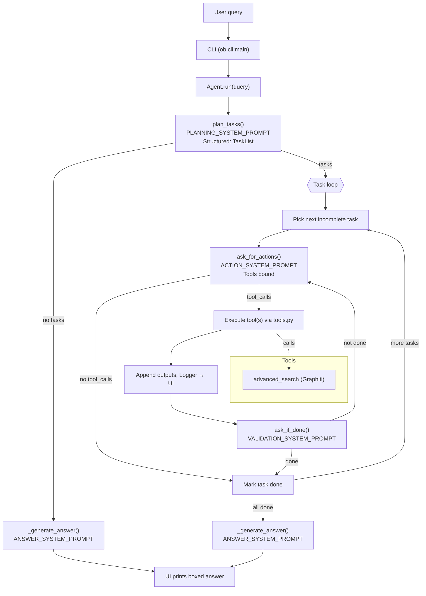

# ob Agent — Codebase Overview

This document explains how the codebase is organized, how execution flows at runtime, and where to extend functionality. It reflects the current repository state.

## High‑Level Architecture

ob is an interactive, multi‑phase agent for organizational insights. It decomposes a user query into tasks, selects tools to fetch or analyze data, validates progress, and synthesizes a final answer.

- Phases: Planning → Action → Validation → Answering
- Tools: typed LangChain tools; currently a Graphiti knowledge‑graph search
- CLI: thin Node.js wrapper delegates to a Python console entrypoint
- UI: lightweight console UI with spinners and structured output

Core building blocks:
- LLM wrapper: `src/ob/model.py`
- Prompts: `src/ob/prompts.py`
- Agent orchestration: `src/ob/agent.py`
- Tools: `src/ob/tools.py` (+ HTTP calls in `src/ob/graphiti.py`)
- CLI loop and env loading: `src/ob/cli.py`
- Presentation/UI: `src/ob/utils/*.py`

## End‑to‑End Flow

1. User starts the CLI
   - Node: `index.js` spawns the Python console script `agent-ob`.
   - Python: `pyproject.toml` exposes `agent-ob = ob.cli:main`.
2. CLI bootstraps
   - Loads `.env` via `dotenv` before importing other modules (ensures API keys are available).
   - Prints an intro banner and starts an interactive REPL using `prompt_toolkit`.
3. Agent lifecycle per query (`Agent.run`)
   - Plans tasks with `PLANNING_SYSTEM_PROMPT` → structured `TaskList`.
   - Asks for next action with `ACTION_SYSTEM_PROMPT` → optional LangChain `tool_calls`.
   - Executes tool(s) and appends results to an in‑memory session log.
   - Validates completion with `VALIDATION_SYSTEM_PROMPT` (boolean `IsDone`).
   - Generates the final answer with `ANSWER_SYSTEM_PROMPT` using all collected data.
4. UI shows progress spinners around long steps and prints a boxed final answer.

## Top‑Level Files

- `README.md`: Product overview, quick start, architecture summary.
- `package.json`: Node wrapper; `postinstall` runs `uv pip install .` so the Python package/console script are available; exposes the `agent-ob` binary.
- `index.js`: Minimal Node launcher that spawns `agent-ob` with inherited stdio.
- `pyproject.toml`: Python packaging and dependencies (LangChain, OpenAI, Pydantic, requests, prompt‑toolkit, dotenv). Declares console entry `agent-ob`.
- `uv.lock`: Locked dependencies for reproducible installs.
- `env.example`: Template for environment variables (`OPENAI_API_KEY`, `GRAPHITI_API_KEY`, optional `GROUP_ID`). Notes that `FINANCIAL_DATASETS_API_KEY` is deprecated and unused by current tools.
- `python.md`: uv cheat sheet and developer tips.

## Python Package: `src/ob`

### `__init__.py`
Marks `ob` as a Python package.

### `cli.py`
Interactive command‑line entrypoint.
- Loads environment via `dotenv` before importing `ob.*` modules.
- Prints intro (`utils/intro.py`).
- Creates `Agent()` and starts an interactive prompt loop (history via `prompt_toolkit`).
- Accepts `exit`/`quit` or Ctrl‑C/Ctrl‑D to terminate.

### `agent.py`
Orchestrates the multi‑phase agent.
- Constructor safety controls: `max_steps` (global) and `max_steps_per_task` (per‑task).
- Uses `Logger` → `UI` for structured, colorful console output.
- Long‑running methods are decorated with `show_progress(...)` for spinners.

Key phases and methods:
- `plan_tasks(query) -> List[Task]`
  - Calls the LLM with `PLANNING_SYSTEM_PROMPT` and `TaskList` schema. On error, falls back to a single generic task (the raw query).
  - Logs a human‑readable task list.
- `ask_for_actions(task_desc, last_outputs) -> AIMessage`
  - Calls the LLM with `ACTION_SYSTEM_PROMPT` and LangChain tool bindings. May return `tool_calls` to execute.
- `ask_if_done(task_desc, recent_results) -> bool`
  - Calls the LLM with `VALIDATION_SYSTEM_PROMPT` expecting `IsDone`.
- `_execute_tool(tool, tool_name, inp_args)`
  - Runs the selected tool with a progress spinner and returns the tool result.
- `confirm_action(...)`
  - Currently auto‑confirms; reserved for future risk gating.
- `run(query)`
  - Plans tasks; if none are returned (out‑of‑scope), skips tools and jumps to answer generation.
  - Iterates tasks with guardrails:
    - Global step cap (`max_steps`).
    - Per‑task cap (`max_steps_per_task`).
    - Stuck detection: if the same action repeats 4 times, aborts to prevent loops.
  - For each tool call: finds the tool in `TOOLS`, executes it, logs outputs, and appends a plain summary to `session_outputs`.
  - After each batch, asks validation; marks the task done when sufficient.
  - Finally, generates the answer and logs it via `Logger`.

### `model.py`
Unified LLM invocation.
- Reads `OPENAI_API_KEY` and selects models via env vars:
  - `OB_LLM_MODEL` (default: `gpt-4o`) for planning/action/validation.
  - `OB_ANSWER_LLM_MODEL` (default: `gpt-5-mini`) for answer generation.
  - Step defaults for the default system prompt can be overridden with `OB_MAX_STEPS`, `OB_MAX_STEPS_PER_TASK`.
- Assembles a ChatPrompt with the chosen system prompt plus current UTC timestamp.
- Chooses the invocation mode:
  - `with_structured_output(output_schema)` when a Pydantic schema is provided.
  - `bind_tools(tools)` when tools are provided.
- Returns the LangChain `AIMessage` (tool calls) or the structured Pydantic model, depending on usage.

### `prompts.py`
Prompt texts for each phase plus a default system prompt and a protocol summary. The default persona is an organizational insights agent; the planning/action/validation/answer prompts enforce phase‑specific behavior and guardrails.

### `tools.py` and `graphiti.py`
Typed tools and HTTP integration.
- `advanced_search` (`@tool`, schema: `AdvancedSearchInSchema`): the primary Graphiti knowledge‑graph search.
  - Inputs: `query` (required), optional `center_node_uuid`, optional `strategy` (`RRF` default; also `MMR`, `CROSS_ENCODER`).
  - Group constraints: `group_ids` are injected from the environment via `GROUP_ID` (single or comma‑separated) and not part of the tool inputs.
- `graphiti.search_advanced(...)` posts to a local Graphiti API:
  - Base URL: `http://127.0.0.1:8000` (change in code as needed).
  - Auth: `X-API-Key` header from `GRAPHITI_API_KEY`.
  - Payload: `query`, optional `center_node_uuid`, injected `group_ids`, and `recipe` = search strategy.
  - Returns parsed JSON from the HTTP response.

### `utils/ui.py`, `utils/logger.py`, `utils/intro.py`
UI and logging utilities.
- `ui.py`
  - `Colors` ANSI helpers; `Spinner` for threaded progress; `show_progress(...)` decorator.
  - `UI` methods: task list, task start/done, tool runs, detailed lines, boxed answer, info/warn/error, `progress(...)` context manager.
- `logger.py`
  - Thin wrapper over `UI` with higher‑level calls used by the agent; keeps a simple in‑memory log.
- `intro.py`
  - Prints a welcome box and ASCII art banner.

## How Components Fit Together

- CLI (`cli.py`) creates a single `Agent` and runs the REPL.
- Agent calls `call_llm(...)` with phase‑appropriate prompts and modes (structured output vs. tools) and delegates visuals to `Logger` → `UI`.
- Tools (`tools.py`) expose a typed surface to the LLM; `graphiti.py` encapsulates HTTP I/O.
- Prompts codify the agent’s behavior and guardrails; swapping models/prompt text is isolated to `model.py`/`prompts.py`.

## Safety and Guardrails

- Bounded loops: global `max_steps` and per‑task `max_steps_per_task`.
- Stuck detection: abort after 4 identical consecutive actions.
- Out‑of‑scope planning: empty plan causes direct answer generation (no tools).
- Tool confirmation: auto‑confirm today; reserve `RISKY_TOOLS` for future gating.

## Error Handling

- Planning: on exception, create a single fallback task.
- Action: on exception, return an `AIMessage` without tool calls (task marked done by control flow).
- Validation: on exception, return `False` (continue until limits).
- Tool execution: catch/log exceptions and continue iterating.

## Configuration and Environment

- Required: `OPENAI_API_KEY` for `langchain_openai.ChatOpenAI`.
- Graphiti (optional/local): `GRAPHITI_API_KEY`; `GROUP_ID` to inject default group IDs (single or comma‑separated).
- Model selection: `OB_LLM_MODEL`, `OB_ANSWER_LLM_MODEL`.
- Guardrails: `OB_MAX_STEPS`, `OB_MAX_STEPS_PER_TASK`.

Note: `FINANCIAL_DATASETS_API_KEY` is deprecated and not used by the current toolchain.

## Extending the Agent

- Add tools in `tools.py` (export in `TOOLS`) with clear `@tool` schemas and descriptions.
- Implement HTTP or SDK logic in adjacent modules (e.g., `graphiti.py`).
- Adjust prompts in `prompts.py` or swap models in `model.py` as needed.
- Customize console UX in `utils/ui.py`.

## Known Limitations

- Assumes LangChain `AIMessage.tool_calls` shape for tool execution.
- No persistent memory beyond the process; session outputs are in‑memory.
- Tool confirmation is a stub; consider interactive confirmation for risky tools.
- No tests included; consider adding unit tests for prompt assembly, schema round‑trips, and HTTP adapters (with mocking).

## Agent Flow Diagram

